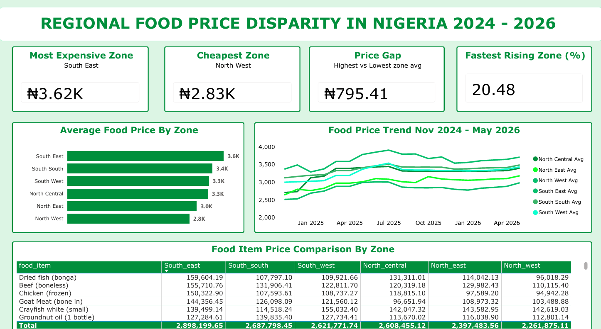
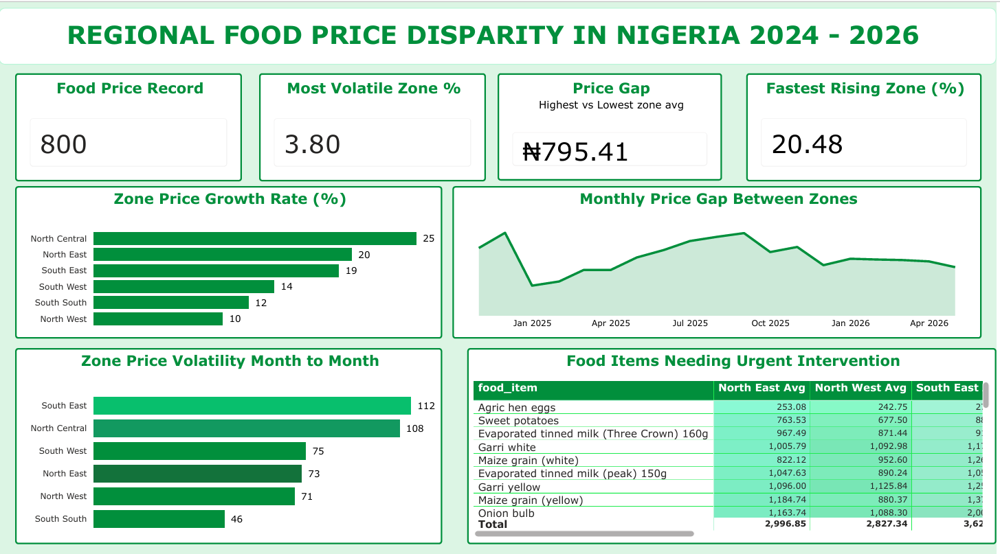

# Regional Food Price Disparity in Nigeria

## Overview
Food prices in Nigeria differ widely across geopolitical zones, but national averages hide this. This project analyses 19 months of NBS Selected Food Prices Watch data (November 2024 to May 2026) across six zones to show where prices are highest, which zones are rising fastest, and where intervention is needed most.

## Data
* **Source:** NBS Selected Food Prices Watch
* **Period:** November 2024 to May 2026
* **Size:** 800 records, 47 food items, 6 zones

## Tools
Excel (cleaning), PostgreSQL (storage and querying), Power BI (dashboard)

## Process
1. Downloaded 19 monthly NBS bulletins
2. Merged them with Power Query and cleaned the data in Excel
3. Standardised 47 food item names
4. Imported the data into PostgreSQL
5. Wrote 9 SQL queries to answer business questions
6. Built an interactive Power BI dashboard

## Key Findings
* South East is the most expensive zone (₦3,623)
* Prices rose 16% over the 19 months
* North Central had the fastest growth (20.48%) and the highest volatility
* The gap between North West and South East is ₦795.41
* Dried fish and protein items show the widest regional gaps

## Recommendations
Investigate supply chain costs in the South East, introduce early price stabilisation in North Central, plan stock ahead of festive seasons, and monitor prices by zone instead of relying on national averages.

## Dashboard

## Project Files
* [Cleaned dataset](data/cleaned/food_prices_cleaned.xlsx)
* [SQL queries](sql/queries.sql)
* [Power BI file](dashboard/food_price_dashboard.pbix)
* [Full report (PDF)](report/food_price_disparity_report.pdf)

## Author
Oluwatomilayo Fasanmi
[LinkedIn](https://www.linkedin.com/in/tomifasanmi/)
